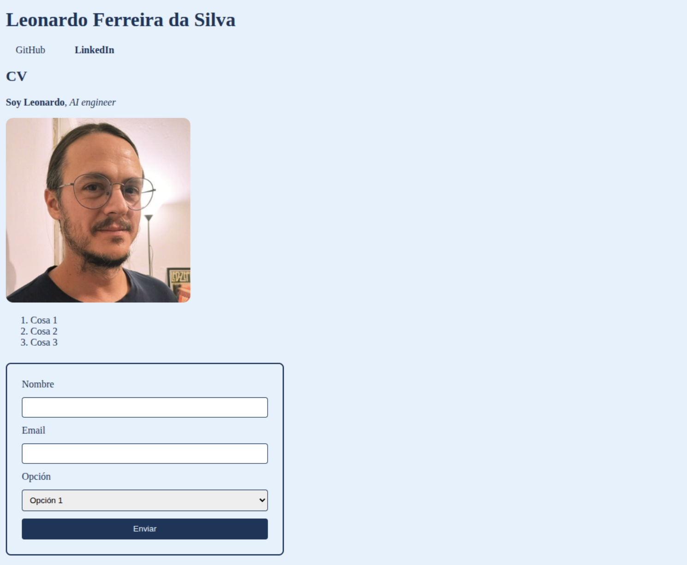

# Esta es una pagina personal sencilla, en el marco de curso de *React JS*

### Hay links a mi github y linkedin.


##### Para clonar el repo, debes hacer 
```bash 
git clone https://github.com/leofds12/curso_react_js.git
``` 
en una terminal dentro de una nueva carpeta. 

##### Al hacer clic derecho en el index.html, y lo abres en un navegador, se debería ver algo así:



